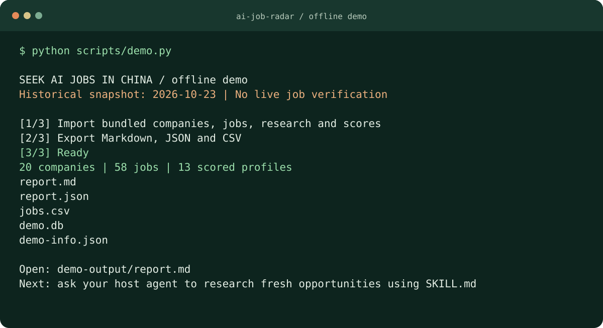

  

<h1 align="center">Seek AI Jobs in China</h1>

  <strong>专为寻找国内 AI 岗位打造的 Agent Skill</strong> 
  大厂与初创 · 社招 / 校招 / 实习 · 公司研究与机会对比

  
  
  
  

  简体中文 · <a href="README_EN.md">English</a>  
  <a href="#quickstart">快速体验</a> · <a href="#examples">先看结果</a> ·
  <a href="#agent">让 Agent 帮你找</a> · <a href="CONTRIBUTING.md">参与贡献</a>

---

**发现大厂与初创的国内 AI 岗位，覆盖社招、校招和实习。** 将岗位与公司融资、创始团队、产品和招聘来源放在一起，生成可追溯的研究报告，帮助你筛选和比较机会。

~~~text
「帮我找北京的 AI 产品经理岗位，看看这些公司的融资、团队和产品，
  把有证据的机会整理成一份报告，不确定的信息请标出来。」
~~~

## 为什么做这个项目

| 你想知道 | 项目帮你整理 |
|---|---|
| 谁在招，适合我吗？ | 实际工作城市、岗位性质、JD、薪资与招聘状态 |
| 这家公司值得进一步了解吗？ | 融资历史、创始团队、团队规模与旗下产品 |
| 可以从哪些信源寻找机会？ | 企业官网、公开招聘页，以及按需启用的补充信源 |
| 这些结论从哪里来？ | 来源 URL、检索时间、事实/推断标注、评分依据与覆盖率 |

**Company-first · Evidence-based · Local-first。** 数据保存在你的本地 SQLite，报告可导出 Markdown、JSON 和 CSV。

## 快速体验：先跑通一份报告

**需要 Git 和 Python 3.11+。** demo 使用随仓库提供的历史样例；安装完成后，无需模型 API Key、浏览器登录或在线采集，就能查看完整流程。

先获取项目：

~~~bash
git clone https://github.com/lucashuang-an/seek-ai-jobs-in-china.git
cd seek-ai-jobs-in-china
~~~

<strong>Windows · PowerShell</strong>

~~~powershell
python -m venv .venv
./.venv/Scripts/python.exe -m pip install -e .
./.venv/Scripts/python.exe scripts/demo.py
~~~

<strong>macOS / Linux</strong>

~~~bash
python3 -m venv .venv
.venv/bin/python -m pip install -e .
.venv/bin/python scripts/demo.py
~~~

打开 **`demo-output/report.md`**，查看公司研究、岗位和评分。这个 demo 使用独立的 `demo-output/demo.db`，不会写入你的默认个人数据库。

  

| 产物 | 用途 |
|---|---|
| `demo-output/report.md` | 直接阅读、分享的公司与岗位研究报告 |
| `demo-output/report.json` | 带岗位证据的结构化输出 |
| `demo-output/jobs.csv` | 用 Excel 或其他表格工具筛选岗位 |
| `demo-output/demo-info.json` | 数据快照日期、记录数量与 demo 元信息 |

> **这是历史样例，不是实时职位榜单。** 上图使用 2026-10-23 数据快照。生成报告不等于重新核验岗位仍在招；想找新机会，请继续使用下面的 Agent 工作流。

## 不安装，也能先看结果

| 样例 | 可以看到什么 |
|---|---|
| [完整研究报告](examples/acceptance_output/report.md) | 多家公司总览、公司档案、评分与来源 |
| [月之暗面公司档案](examples/acceptance_output/moonshot.md) | 一份公司研究报告的结构与证据呈现 |
| [小红书发现的初创招聘样例](examples/acceptance_output/xhs_omnimind.md) | 公开招聘帖如何落成公司与岗位记录 |
| [实习岗位表](examples/acceptance_output/intern_jobs_20261023.csv) | 实习筛选结果，下载后可在表格工具打开 |

以上是仓库保留的历史产物，供体验输出格式；岗位、公司信息和评分均需在实际求职前重新核验。

## 让 Agent 帮你研究新机会

在能访问本仓库、并支持联网搜索/浏览器的宿主 Agent 中，粘贴下面的需求：

~~~text
请先阅读本仓库的 SKILL.md，并按其中的工作流执行。

帮我寻找北京的 AI 产品经理 / Agent 产品岗位，实际工作地点须在中国大陆。
优先了解 AI 初创公司的融资、创始团队、产品和招聘机会；
搜索官网与公开招聘页，区分社招、校招和实习岗位。
每个事实保留来源与检索时间；未知填 null，推断单独标记。
请先说明将查询的信源，再将结果导入本地库，导出 Markdown 报告。
遇到登录墙时让我在浏览器中自行登录，不要绕过验证码或风控。
~~~

也可以从一个更具体的问题开始：

- **找实习**：「帮我找上海的 AI 产品实习，区分实习、校招和社招。」
- **研究公司**：「研究月之暗面的融资、团队和产品，标出缺失信息。」
- **比较机会**：「比较这三家公司的产品方向、团队和招聘质量，附上依据。」

**分工很明确：宿主 Agent 负责联网发现、阅读与研究；本仓库负责结构化导入、实体匹配、去重、状态核验、评分计算和报告导出。** CLI 的 `discover` / `jobs` 查询本地库，不会自动发起一次全网搜索。宿主的模型和浏览器能力按你所用环境配置。

## 小红书：补充招聘平台之外的线索

这是一个**可选补充信源**，需要宿主 Agent 提供 browser use，且用户已在浏览器中登录小红书。具备这些条件后，可将公开帖子中的早期团队招聘、实习和个人内推线索纳入公司研究；参考[历史采集样例](examples/data/xhs_jobs_20261023.json)。

- **在用户会话内协作**：宿主浏览器遇到登录墙时，由用户自行登录后继续读取公开内容。
- **保留信源差异**：官方账号与个人内推分别注明来源和可信度说明。
- **受限就保留不确定性**：匿名访问被拦截时标记 `Unknown`，不据此判断招聘已结束。

这是宿主 Agent 工作流，仓库没有提供独立的小红书自动爬虫。能力与限制见[数据源评估](docs/数据源评估_小红书.md)。

## CLI：导入、筛选、核验、导出

安装后可用 `ai-job-radar`。如果虚拟环境未激活，用对应环境的 Python 执行 `-m ai_job_radar.cli` 即可。下面的命令查询 demo 数据库：

~~~bash
ai-job-radar discover --city 北京 --track "AI Agents" --db demo-output/demo.db
ai-job-radar jobs --city 北京 --keyword "产品经理" --db demo-output/demo.db
ai-job-radar research --company "月之暗面" --db demo-output/demo.db
ai-job-radar export --company "月之暗面" --out demo-output/moonshot --db demo-output/demo.db
~~~

Agent 调研后，经以下命令导入你自己的本地库：

~~~bash
ai-job-radar import-companies companies.json
ai-job-radar import-jobs jobs.json
ai-job-radar import-research research.json
ai-job-radar import-scores scores.json
ai-job-radar verify --company "公司名"
ai-job-radar export --format markdown --out report
~~~

JSON 输入格式可参考 [examples/data](examples/data)。默认库为 `~/.ai_job_radar/ai_jobs.db`，用 `--db` 指向其他库。`verify` 会访问岗位原始页面，结果取决于页面内容与访问限制。

<strong>数据更新、评分与导出规则</strong>

- 公司部分更新保留未提供的字段；显式 `null` / 空列表可以清空对应字段。
- 岗位合并补全缺失字段并保留各来源；岗位性质或同平台职位 ID 不同的记录分别保留。
- 相同研究事实重复导入不会新增副本，不同内容并列保留。
- 五维评分：融资 25%、创始团队 25%、团队组织 15%、产品 25%、招聘质量 10%。缺证据的维度不打分，其余维度权重归一化，并报告覆盖率。
- 源码运行时默认读取 `configs/scoring.yaml`，安装包使用包内默认配置。可用 `import-scores scores.json --weights path/to/scoring.yaml` 覆盖；五个权重均须为有限正数。
- `export --city 北京` 在三种格式中均按岗位实际工作城市筛选。JSON 岗位条目为 `{"job": {...}, "evidence": [...]}`。

<strong>npm 包装器（本地测试入口）</strong>

目前推荐上面的源码安装流程；仓库中的 [npm 包装器](npm/README.md) 也可本地安装测试，不依赖 registry 已发布：

~~~bash
npm install -g ./npm
~~~

需要 Node.js 16+、Python 3.11+ 和 Git。首次运行会创建独立 Python 环境，默认从 GitHub 安装核心；本地核心开发可通过 `AI_JOB_RADAR_PKG` 指向仓库绝对路径。包装器提供同一套 CLI。

## 常见问题

**装好以后查询是空的？** 首次安装没有个人数据。先运行 `scripts/demo.py`，查询时加 `--db demo-output/demo.db`；或让宿主 Agent 调研后导入默认库。

**为什么岗位不是全部 Verified Open？** 页面可访问不等于 HC 仍开放。系统区分 `Verified Open`、`Listed / Unconfirmed`、`Recently Seen`、`Closed`、`Unknown`，保留无法确认的状态。

**哪些城市可用？** 当前收录北京、上海、深圳、杭州、广州、成都、南京、武汉、苏州。导入时其他城市会被过滤；仅标注 Global Remote 且实际地点未知的岗位保留为待核验。

**需要额外账号或 API Key 吗？** 离线 demo 和 CLI 的本地数据处理无需模型 Key；联网研究使用你现有宿主 Agent 的模型与浏览器能力。登录由你在宿主浏览器中完成，不要把 Cookie、令牌或私密内容导入项目。

**会自动投递或联系 HR 吗？** 当前范围是发现与研究，不提供自动投递、简历生成、私信或招聘交易功能。MCP 接入处于规划阶段。

## 开发与参与

~~~bash
python -m pip install -e ".[dev]"
python -m pytest -q
python scripts/acceptance_run.py
~~~

当前本地验证：56 项测试、13 项场景验收通过；CI 状态见顶部实时徽章。历史验收记录见[验收报告](docs/验收报告_V0.2.md)。

- [贡献指南](CONTRIBUTING.md)：补充公司、公开信源、纠错或改进首次体验。
- [推荐一个信源](https://github.com/lucashuang-an/seek-ai-jobs-in-china/issues/new?template=source-suggestion.yml)：附公开链接和观察日期。
- [分享文案与图片](docs/SHARING.md)：把项目介绍给正在找 AI 机会的朋友。
- [产品与技术方案](docs/产品与技术方案_V1.1.txt)：了解范围、流程与数据约束。

如果这套工作流对你有用，欢迎 [Star](https://github.com/lucashuang-an/seek-ai-jobs-in-china/stargazers) 收藏，或分享一条值得研究的公开招聘线索。

[Apache-2.0](LICENSE) · 独立开源项目，与招聘平台及被研究公司无关联。
